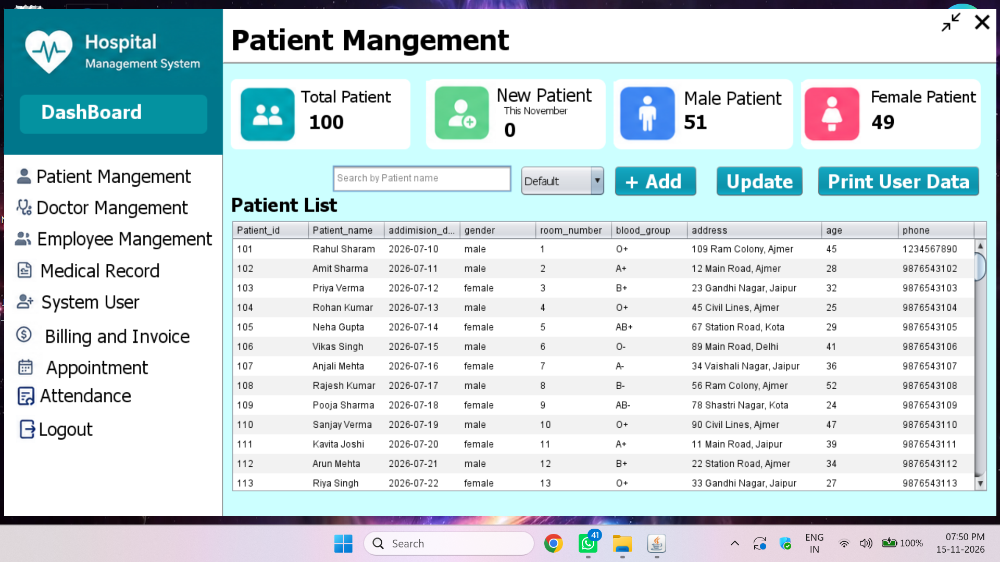
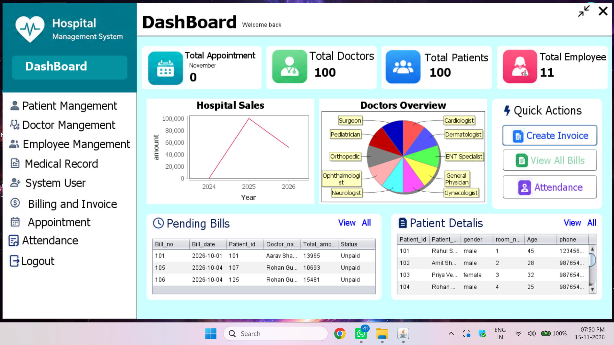
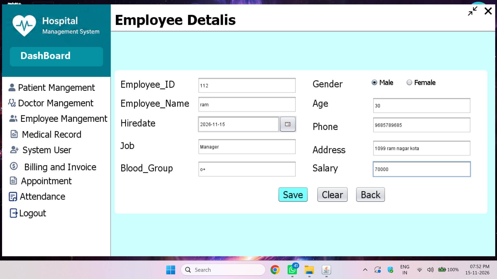
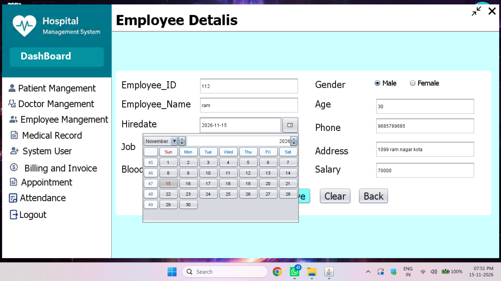
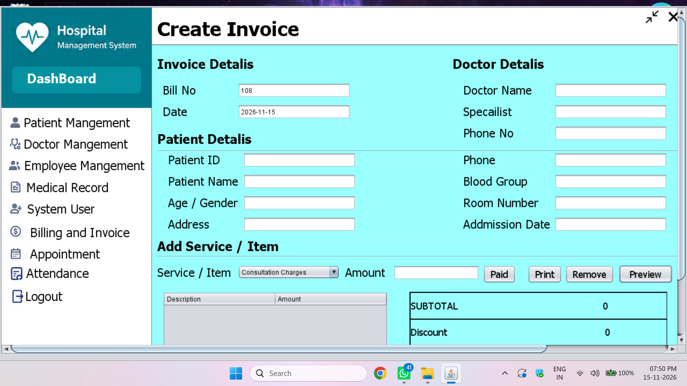

# Hospital Management System

A desktop Hospital Management System built with **Java Swing (GUI)** and **MySQL**. The project source includes NetBeans GUI Builder `.form` files, Java classes, application images, and supporting libraries.

## Modules included in the source

- Patient management
- Doctor management
- Employee management
- Hospital details
- Medical records and medicine stock
- Medicine purchase/sales reports and medicine billing
- Patient billing and invoice management
- Appointments
- Attendance
- System user management
- Login, sign-up, and password reset
- Main dashboard and search screens

## Technology

- Java Swing
- MySQL
- MySQL Connector/J (included in `lib/`)
- NetBeans GUI Builder form files (`.form`)

## Repository structure

```text
Health-Care/
├── database/                             # MySQL database schema
├── jre/                                  # Contains the JRE required to run the application without installing Java separately.
├── lib/                                  # Required third-party JAR libraries
├── src/                                  # Java source, NetBeans .form files, images
├── Health Care software and Database setup guide.pdf
├── health_care.exe
├── health_care.xml
├── README.md
└── .gitignore
```

## Database setup

1. Install MySQL Server and start the MySQL service.
2. Open MySQL Workbench or the MySQL command line.
3. Run the SQL script `health_care_database.sql` to create the `health_care` database and its tables.
4. Configure the database username and password to match your local MySQL setup.

### Existing connection settings to check

The supplied Java source currently connects to `localhost:3306/health_care` using the MySQL `root` account with an empty password in many classes. Before running the application, update these connection settings to match your own local MySQL configuration.

**Security:** Do not use an empty MySQL root password outside a local development environment. Do not add real patient records, personal information, or production credentials to this public repository.

## Open in NetBeans

This upload contains the `src/` and `lib/` folders and the NetBeans `.form` files, but it does **not** contain the original NetBeans `nbproject/` metadata or Ant `build.xml`. To work with it in NetBeans, create/open a Java project and add the supplied source files and JARs from `lib/` to the project. Preserve the package folder structure under `src/`.

## Run

After setting up MySQL and adding the JAR libraries, build the project in NetBeans. The source contains individual form launchers for testing; use the application's splash/login flow as the normal entry point once the project is configured.

## Developer

**Jayant Keswani**

## Screenshot











